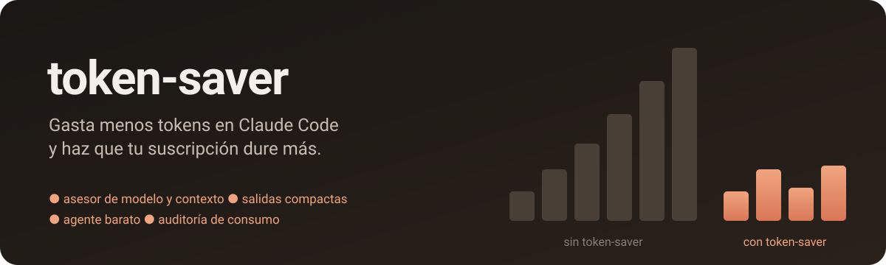
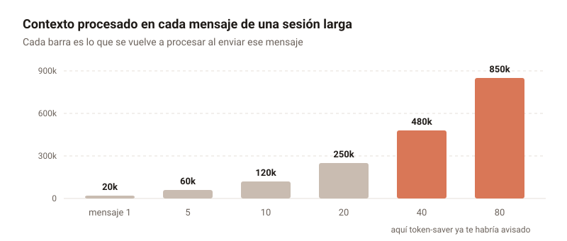
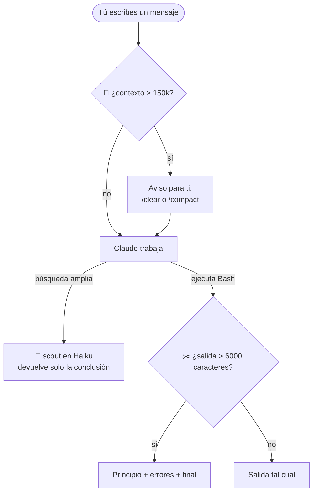

<p align="center">
  
</p>

<p align="center">
  
  
  
  
</p>

<p align="center">
  <b>Un plugin de Claude Code que te avisa cuando una sesión se vuelve cara, recorta las salidas ruidosas de la terminal,<br>
  delega búsquedas a un modelo barato y te enseña con tus propios datos dónde se van los tokens.</b>
</p>

---

## Índice

- [El problema](#el-problema)
- [Qué incluye](#qué-incluye)
- [Cómo funciona](#cómo-funciona)
- [Instalación](#instalación)
- [Uso](#uso)
- [Configuración](#configuración)
- [Los hábitos que más ahorran](#los-hábitos-que-más-ahorran)
- [Estructura del repo](#estructura-del-repo)
- [Limitaciones](#limitaciones)

---

## El problema

En Claude Code, **cada mensaje vuelve a procesar toda la conversación**: tus mensajes, las respuestas, cada fichero leído y cada salida de terminal. Una sesión no cuesta lo que dice su último mensaje, sino la suma del contexto en cada turno.

<p align="center">
  
</p>

Al medir 30 días de uso real con la auditoría de este plugin salió esto:

| Métrica | Valor |
|---|---|
| Contexto medio por llamada al modelo | **~350k tokens** |
| Pico de contexto en una sesión | **~970k tokens** |
| Salida media de un comando Bash | ~500 tokens |
| Uso que fue a Opus | 87 % |

La conclusión: **lo que más gasta es la longitud de las sesiones**, mucho más que cualquier comando concreto. Por eso la pieza central de token-saver es el aviso de contexto. Las demás piezas atacan las fugas secundarias.

---

## Qué incluye

| | Pieza | Tipo | Qué hace | Coste en tokens |
|---|---|---|---|---|
| 🚨 | **Aviso de contexto** | Hook `UserPromptSubmit` | Cuando el contexto pasa de 150k, te avisa (una vez por cada 100k más) para que hagas `/clear` o `/compact`. | **0**: el aviso lo ves tú, no entra en el contexto |
| ✂️ | **Salidas compactas** | Hook `PostToolUse` | Si un comando Bash imprime más de 6000 caracteres, Claude recibe el principio, las líneas de error/warning y el final. La salida completa queda en un fichero temporal. | **Ahorra** (en la prueba, ~90 %) |
| 🔭 | **Agente `scout`** | Subagente (Haiku) | Explorador de solo lectura: busca en el código y devuelve solo la conclusión con `ruta:línea`. | Mucho más barato que Opus |
| 📊 | **`/token-saver:audit`** | Skill | Analiza tus transcripciones locales y genera un informe: sesiones más caras, reparto por modelo, herramientas y comandos que más ocupan. | Solo el informe |

---

## Cómo funciona



### ✂️ Así queda una salida compactada

**Antes**: 800 líneas, ~29 500 caracteres

```text
  ✓ test case number 0 passed fine
  ✓ test case number 1 passed fine
  ✓ test case number 2 passed fine
  … 397 líneas más …
  FAIL src/app.test.ts > adds numbers
  … 399 líneas más …
  ✓ test case number 799 passed fine
```

**Después**: ~3 300 caracteres (−89 %)

```text
  ✓ test case number 0 passed fine
  … (primeras 30 líneas)
… [720 lines omitted; 1 error/warning lines kept below] …
  FAIL src/app.test.ts > adds numbers
… [end of kept lines] …
  ✓ test case number 750 passed fine
  … (últimas 50 líneas)
[token-saver: output compacted from 29508 chars.
 Full output: …/token-saver-….log]
```

Los comandos con los que Claude pide una salida concreta a propósito **no se tocan nunca**: `cat`, `sed`, `head`, `tail`, `grep`, `rg`, `awk`, `jq`, `git diff`, `git show`, `git blame`. Para saltarte el recorte en cualquier otro comando, añade `# full` al final.

---

## Instalación

> Requisitos: [Claude Code](https://code.claude.com) y Node 18 o superior.

**Desde GitHub** (recomendado):

```bash
claude plugin marketplace add envyx10/token-saver
```

```bash
claude plugin install token-saver@pgdiaz-tools
```

**Desde una copia local**, si quieres modificarlo:

```bash
git clone https://github.com/envyx10/token-saver.git
```

```bash
claude plugin marketplace add ./token-saver
```

```bash
claude plugin install token-saver@pgdiaz-tools
```

Después **abre una sesión nueva**: los hooks se cargan al arrancar. Para comprobar que está activo:

```bash
claude plugin list
```

<details>
<summary>Desinstalar</summary>

```bash
claude plugin uninstall token-saver@pgdiaz-tools
```

```bash
claude plugin marketplace remove pgdiaz-tools
```

</details>

---

## Uso

### 📊 Auditoría

```text
/token-saver:audit
/token-saver:audit --days 30
/token-saver:audit --days 14 --project mi-proyecto
```

| Opción | Por defecto | Qué hace |
|---|---|---|
| `--days N` | `7` | Ventana de tiempo a analizar |
| `--project texto` | todos | Solo proyectos cuya ruta contenga ese texto |
| `--top N` | `8` | Filas de cada tabla |

<details>
<summary>Ejemplo de informe</summary>

```text
# Token audit — last 30 days
29 sessions · 8993 model calls · 3111.9M context tokens processed · 6.9M output · avg context per call 346k

## By model (context + output)
- claude-opus-5-5: 2712.1M (87%)
- claude-opus-5: 406.3M (13%)

## Most expensive sessions
| session                    | calls          | context processed | peak context | tool output |
|----------------------------|----------------|-------------------|--------------|-------------|
| Proyecto A: nueva feature  | 1399 (162 sub) | 606.3M            | 888k         | ~729k tok   |
| Proyecto B: rediseño web   | 1788 (447 sub) | 600.9M            | 847k         | ~576k tok   |

## Noisiest shell commands
- sed -n: ~190k tok in 227 calls (avg ~837)
- python -: ~102k tok in 208 calls (avg ~491)

## Suggestions
- 12 session(s) went over 120k context. Every turn re-reads that: /clear between tasks, /compact on long ones.
- Over 80% of usage is Opus. Default to Sonnet for routine work and switch to Opus for hard problems.
```

</details>

El script lee los ficheros en disco y solo el informe entra en la conversación, así que la auditoría apenas gasta tokens. También puedes ejecutarlo fuera de Claude Code:

```bash
node plugins/token-saver/scripts/audit.js --days 30
```

### 🔭 Agente scout

Claude lo usa solo cuando le encaja la tarea, pero puedes pedírselo directamente:

```text
Usa el agente scout para encontrar dónde se valida el token de sesión
```

### 🚨 Aviso de contexto

No hay que hacer nada. Cuando aparezca este mensaje, decide:

```text
token-saver: context is ~320k tokens and every message re-processes all of it. New task? /clear. Same task? /compact.
```

| Situación | Qué hacer |
|---|---|
| Vas a empezar otra tarea | `/clear` |
| Sigues con la misma tarea | `/compact` |
| Necesitas todo el historial | Sigue. El aviso no vuelve hasta 100k más |

---

## Configuración

Todo se ajusta con variables de entorno. Lo más cómodo es ponerlas en el bloque `env` de `~/.claude/settings.json`:

```json
{
  "env": {
    "TOKEN_SAVER_WARN_AT": "120000",
    "TOKEN_SAVER_MAX_CHARS": "8000"
  }
}
```

| Variable | Por defecto | Qué controla |
|---|---|---|
| `TOKEN_SAVER_WARN_AT` | `150000` | Tokens de contexto a partir de los que llega el primer aviso |
| `TOKEN_SAVER_MAX_CHARS` | `6000` | Caracteres de salida de Bash a partir de los que se compacta |
| `TOKEN_SAVER_COMPACT` | `1` | Pon `0` para desactivar la compactación |

---

## Los hábitos que más ahorran

El plugin avisa y mide, pero lo que más ahorra son estos hábitos:

| # | Hábito | Por qué |
|---|---|---|
| 1 | **Una sesión por tarea**, con `/clear` al terminar | El contexto se paga en cada mensaje |
| 2 | **Sonnet por defecto**, Opus solo para lo difícil | Opus consume el límite bastante más rápido |
| 3 | **Activa solo los MCP que usa cada proyecto** | Las definiciones de herramientas ocupan contexto en cada sesión |
| 4 | **CLAUDE.md corto** | Se carga entero en cada sesión |
| 5 | **Delega las búsquedas amplias a `scout`** | A tu sesión solo llega la conclusión |
| 6 | **Esfuerzo medio o bajo** para tareas sencillas | Pensar menos produce menos tokens de salida |

---

## Estructura del repo

```text
token-saver/
├── .claude-plugin/
│   └── marketplace.json         # marketplace "pgdiaz-tools"
├── assets/
│   ├── banner.svg
│   └── context-growth.svg
└── plugins/token-saver/
    ├── .claude-plugin/
    │   └── plugin.json          # manifiesto del plugin
    ├── hooks/
    │   └── hooks.json           # registra los dos hooks
    ├── scripts/
    │   ├── context-guard.js     # 🚨 aviso de contexto
    │   ├── compact-output.js    # ✂️ salidas compactas
    │   └── audit.js             # 📊 auditoría
    ├── agents/
    │   └── scout.md             # 🔭 agente Haiku
    └── skills/audit/
        └── SKILL.md             # /token-saver:audit
```

Sin dependencias: solo Node y su librería estándar.

---

## Limitaciones

- **El formato de las transcripciones de Claude Code es interno** y puede cambiar entre versiones. Si la auditoría o el aviso de contexto dejan de funcionar tras una actualización, probablemente sea por eso.
- La auditoría estima los tokens de las salidas de herramientas a razón de ~4 caracteres por token. Los totales de contexto y de salida, en cambio, son los que registra Claude Code.
- La compactación usa heurísticas: si alguna vez se pierde una línea importante, Claude puede leer la salida completa desde el fichero temporal, y tú puedes añadir `# full` al comando.
- Los avisos y notas del plugin están en inglés.

---

<p align="center">
  Licencia <a href="LICENSE">MIT</a> · Hecho para que la suscripción llegue a final de mes.
</p>
